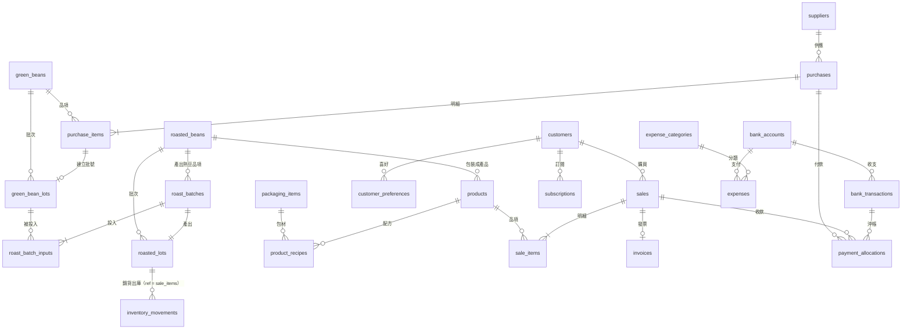

# 咖啡烘豆進銷存系統 — 系統架構與資料表設計

> 本文件為 [README.md](./README.md) 的詳細規格。
> 欄位標記：**PK** 主鍵、**FK** 外鍵、**IDX** 建議索引、`auto` 系統自動計算
>
> **實作狀態**：Phase 1～5 已完成（建表語法見 `db/schema.sql`；既有資料庫升級見 `db/migrations/`）。實作決議與對原規格的調整集中記錄在 [第 11 節](#11-phase-1-實作決議)（Phase 1）與 [第 12 節](#12-phase-2-實作決議)（Phase 2）、[第 13 節](#13-期初庫存)（期初庫存）、[第 14 節](#14-phase-3-實作決議)（Phase 3）、[第 15 節](#15-phase-4-實作決議)（Phase 4）、[第 16 節](#16-phase-5-實作決議)（Phase 5），各表欄位也已同步更新。
> 技術選型：Cloudflare Pages（前端）＋ Pages Functions／Workers（API）＋ D1（SQLite）。

---

## 目錄

1. [模組總覽](#1-模組總覽)
2. [主檔](#2-主檔)
3. [交易](#3-交易)
4. [庫存與生產](#4-庫存與生產)
5. [財務](#5-財務)
6. [系統](#6-系統)
7. [資料表關聯（ER）](#7-資料表關聯er)
8. [業務規則](#8-業務規則)
9. [日期區間查詢與報表](#9-日期區間查詢與報表)
10. [原規劃檢查結果](#10-原規劃檢查結果)
11. [Phase 1 實作決議](#11-phase-1-實作決議)
12. [Phase 2 實作決議](#12-phase-2-實作決議)
13. [期初庫存](#13-期初庫存)
14. [Phase 3 實作決議](#14-phase-3-實作決議)
15. [Phase 4 實作決議](#15-phase-4-實作決議)
16. [Phase 5 實作決議](#16-phase-5-實作決議)

---

## 1. 模組總覽

| 模組 | 資料表 | 狀態 |
|---|---|---|
| 主檔 | 供應商 suppliers | 原規劃 |
| | 客戶 customers | 原規劃 |
| | 客戶喜好 customer_preferences | 原規劃 |
| | 產品 products | 原規劃 |
| | 生豆品項 green_beans | **新增** |
| | 熟豆品項 roasted_beans | **新增**（Phase 2：烘焙產出的熟豆，產品指定使用哪個熟豆） |
| | 配方 product_recipes | **新增**（Phase 4 完成） |
| | 包材 packaging_items | **新增**（主檔與進貨已提前至 Phase 1） |
| | 銀行帳戶 bank_accounts | **新增**（Phase 3 完成） |
| 交易 | 進貨 purchases / purchase_items | 原規劃（Phase 1 完成） |
| | 銷貨 sales / sale_items | 原規劃（Phase 2 完成） |
| | 退貨／折讓 returns / return_items | **新增**（Phase 4 完成） |
| | 訂閱訂單 subscriptions | **新增**（Phase 4 完成） |
| | 發票 invoices | **新增**（Phase 4 完成） |
| 庫存與生產 | 生豆庫存 green_bean_lots | 原規劃（改為批號制） |
| | 烘焙批次 roast_batches / roast_batch_inputs | **新增**（Phase 2 完成） |
| | 熟豆庫存 roasted_lots | **新增**（Phase 2 完成） |
| | 庫存異動 inventory_movements | **新增** |
| | 盤點 stock_counts / stock_count_items | **新增**（Phase 4 完成） |
| | 單號流水號 doc_sequences | **新增**（Phase 1；Phase 2 加入 R、S；Phase 3 加入 T、E；Phase 4 加入 RT、C） |
| 財務 | 銀行收支 bank_transactions | 原規劃（Phase 3 完成） |
| | 收付款沖帳 payment_allocations | **新增**（Phase 3 完成） |
| | 費用支出 expenses | **新增**（Phase 3 完成） |
| | 費用類別 expense_categories | **新增**（Phase 3 完成） |
| 系統 | 使用者 users | **新增** |
| | 操作日誌 audit_logs | **新增** |

---

## 2. 主檔

### 2.1 供應商 `suppliers`

| 欄位 | 型別 | 說明 |
|---|---|---|
| supplier_id | PK | 供應商編號 |
| name | text | 名稱 |
| tax_id | text | 統一編號 |
| contact_name | text | 聯絡人 |
| phone / email | text | 聯絡方式 |
| address | text | 地址 |
| country | text | 國家（國外生豆商） |
| payment_terms | text | 付款條件（現結／月結 30 天） |
| bank_info | text | 匯款資訊 |
| note | text | 備註 |
| is_active | bool | 是否啟用 |
| created_at / updated_at | datetime | |

### 2.2 客戶 `customers`

| 欄位 | 型別 | 說明 |
|---|---|---|
| customer_id | PK | 客戶編號 |
| name | text | 姓名／公司名 |
| customer_type | enum | 零售／批發／咖啡廳／電商 |
| price_level | enum | 價格等級（零售價／批發價／VIP） |
| tax_id | text | 統一編號（開三聯式發票用） |
| phone / email / line_id | text | 聯絡方式 |
| shipping_address | text | 收件地址 |
| payment_terms | text | 現結／月結 |
| credit_limit | decimal | 信用額度（批發客戶） |
| birthday | date | 生日（行銷用，選填） |
| source | text | 客戶來源 |
| note | text | 備註 |
| is_active | bool | |
| created_at / updated_at | datetime | |

### 2.3 客戶喜好 `customer_preferences`（客戶子表，一個客戶可有多筆；Phase 1 已實作）

| 欄位 | 型別 | 說明 |
|---|---|---|
| pref_id | PK | |
| customer_id | FK → customers | |
| roast_level | enum | 淺焙／中焙／中深焙／深焙 |
| flavor_notes | text | 偏好風味（花香、果酸、堅果、巧克力） |
| grind_size | enum | 原豆／手沖／義式／法壓／冷萃 |
| brew_method | text | 沖煮器具 |
| favorite_products | text | 常買品項 |
| dislikes | text | 不喜歡的風味 |
| note | text | |
| updated_at | datetime | |

### 2.4 生豆品項 `green_beans`

| 欄位 | 型別 | 說明 |
|---|---|---|
| bean_id | PK | 生豆品項編號 |
| name | text | 品名（例：衣索比亞 耶加雪菲 G1） |
| country | text | 國家 |
| region | text | 產區 |
| farm | text | 莊園／處理廠 |
| process | enum | 水洗／日曬／蜜處理／厭氧／其他 |
| variety | text | 品種 |
| altitude | text | 海拔 |
| crop_year | text | 產季 |
| cupping_score | decimal | 杯測分數 |
| default_supplier_id | FK → suppliers | 常用供應商 |
| safety_stock_kg | decimal | 安全庫存量 |
| note | text | |
| is_active | bool | |
| created_at / updated_at | datetime | |

### 2.5 產品 `products`

| 欄位 | 型別 | 說明 |
|---|---|---|
| product_id | PK | 產品編號 |
| sku | text | 料號／條碼（不可重複，可空白） |
| name | text | 產品名稱 |
| category | enum | 單品豆／綜合豆／濾掛／禮盒／器具／其他 |
| roast_level | enum | 烘焙度 |
| roasted_bean_id | FK → roasted_beans | **使用哪個熟豆品項**（Phase 2）。空白 = 銷貨時不扣熟豆（器具、禮盒） |
| net_weight_g | int | 每包淨重（g）。有指定熟豆品項時必填，銷貨扣熟豆 kg = 數量 × 淨重 ÷ 1000 |
| retail_price | decimal | 零售價 |
| wholesale_price | decimal | 批發價 |
| shelf_life_days | int | 賞味期（天，從烘焙日起算；僅供產品標示參考，熟豆批次的賞味期限以熟豆品項為準） |
| note | text | 備註 |
| is_active | bool | |
| created_at / updated_at | datetime | |

> 同一鍋熟豆可包成不同規格：「招牌綜合 250g」與「招牌綜合 1kg」是兩個產品，但指向同一個熟豆品項、共用同一份熟豆庫存。

### 2.6 配方 `product_recipes`（產品 BOM；Phase 4 已實作，只放包材）

| 欄位 | 型別 | 說明 |
|---|---|---|
| recipe_id | PK | |
| product_id | FK → products | 產品（刪除產品時一併刪除） |
| packaging_id | FK → packaging_items | 包材（同一產品不重複） |
| qty | decimal | 每一個產品單位用幾個 |

> 例：「耶加雪菲 濾掛 10入」= 濾掛袋 10 個 ＋ 標籤 1 張。熟豆**不在配方裡**，仍依 `products.roasted_bean_id × net_weight_g` 扣（見第 15 節）。原規格的 component_type／component_id 簡化掉。

### 2.7 包材 `packaging_items`

| 欄位 | 型別 | 說明 |
|---|---|---|
| packaging_id | PK | |
| name | text | 名稱（250g 單向閥夾鏈袋、標籤、濾掛袋、禮盒） |
| unit | text | 單位 |
| unit_cost | decimal | 參考單價 |
| supplier_id | FK → suppliers | |
| safety_stock | int | 安全庫存 |
| note | text | 備註 |
| is_active | bool | 是否啟用 |
| created_at / updated_at | datetime | |

> 包材庫存同樣由 `inventory_movements`（item_type = 包材）加總，見 view `v_packaging_stock`。

### 2.8 銀行帳戶 `bank_accounts`（Phase 3 已實作）

| 欄位 | 型別 | 說明 |
|---|---|---|
| account_id | PK | |
| account_name | text | 帳戶名稱（例：台銀公司戶、門市現金、LINE Pay） |
| account_type | enum | 銀行／現金／LINE Pay／信用卡收單／電商平台 |
| bank_name | text | 銀行名稱 |
| account_no_masked | text | 帳號末四碼（最多 4 位數字，不存完整帳號） |
| opening_balance | decimal | 期初餘額（不可為負） |
| opening_date | date | 期初日期；該帳戶的交易日期不可早於此日 |
| note | text | 備註 |
| is_active | bool | |
| created_at / updated_at | datetime | |

> 現金、LINE Pay、刷卡收單也各建一個帳戶，所有收付款都透過帳戶登錄。

### 2.9 熟豆品項 `roasted_beans`（Phase 2 新增）

| 欄位 | 型別 | 說明 |
|---|---|---|
| roasted_bean_id | PK | |
| name | text | 名稱（例：招牌綜合 中深焙、耶加雪菲 水洗 淺焙） |
| roast_level | enum | 淺焙／中焙／中深焙／深焙 |
| shelf_life_days | int | 賞味期（天，烘焙日起算）→ 熟豆批次的 `best_before` |
| safety_stock_kg | decimal | 安全庫存量 |
| note | text | |
| is_active | bool | |
| created_at / updated_at | datetime | |

> 烘焙批次產出的是「熟豆品項」，不是產品；產品透過 `products.roasted_bean_id` 指定使用哪個熟豆品項。

---

## 3. 交易

### 3.1 進貨 `purchases`（表頭）

| 欄位 | 型別 | 說明 |
|---|---|---|
| purchase_id | PK | 內部流水編號（整數） |
| purchase_no | text UNIQUE | 進貨單號。自動產生 `P{YYYYMMDD}-{NN}`（例：P20261114-01），存檔前可手動修改 |
| purchase_date | date **IDX** | 進貨日期 |
| supplier_id | FK → suppliers **IDX** | |
| items_amount | decimal `auto` | 明細小計合計 |
| shipping_fee | decimal | 運費／報關費（攤入生豆成本） |
| tax_amount | decimal | 稅額（攤入生豆成本） |
| total_amount | decimal `auto` | 合計 = 明細小計 + 運費 + 稅額 |
| invoice_no | text | 供應商發票號碼 |
| payment_status | enum `auto` | 未付／部分付款／已付清（Phase 1 一律「未付」，Phase 3 沖帳後自動更新） |
| due_date | date | 應付日期 |
| note | text | |
| created_by | text | 操作者 email（Cloudflare Access） |
| created_at / updated_at | datetime | |

> 金額一律新台幣；國外供應商請換算成台幣後輸入。

### 3.2 進貨明細 `purchase_items`

| 欄位 | 型別 | 說明 |
|---|---|---|
| item_id | PK | |
| purchase_id | FK → purchases | |
| line_no | int | 明細行號（同一張單內不重複） |
| item_type | enum | 生豆／包材（「其他」尚未開放） |
| bean_id / packaging_id | FK | 品項（依 item_type 二擇一） |
| qty | decimal | 數量（生豆 kg／包材依主檔單位） |
| unit_price | decimal | 單價 |
| amount | decimal `auto` | 小計 = 數量 × 單價 |
| alloc_amount | decimal `auto` | 攤入的運費＋稅額（只有生豆有，包材為 0） |
| landed_unit_cost | decimal `auto` | 入庫單位成本 =（小計 + 攤提）÷ 數量 |
| note | text | |

> 生豆批號 `lot_no` 不存在明細表，存檔時寫入 `green_bean_lots`（以 `purchase_item_id` 一對一對應）。

### 3.3 銷貨 `sales`（表頭；Phase 2 已實作）

| 欄位 | 型別 | 說明 |
|---|---|---|
| sale_id | PK | 內部流水編號（整數） |
| sale_no | text UNIQUE | 銷貨單號。自動產生 `S{YYYYMMDD}-{NN}`，存檔前可手動修改 |
| sale_date | date **IDX** | 銷貨日期 |
| customer_id | FK → customers **IDX** | 散客可為空 |
| channel | enum | 門市／電話／LINE／官網／蝦皮／批發 |
| subtotal | decimal `auto` | 明細小計合計 |
| discount | decimal | 折扣（不可大於小計） |
| shipping_fee | decimal | 向客戶收的運費 |
| total_amount | decimal `auto` | 合計 = 小計 − 折扣 + 運費 |
| cost_amount | decimal `auto` | 明細成本合計（出貨當下的熟豆成本） |
| payment_method | enum | 現金／轉帳／LINE Pay／刷卡／貨到付款／月結 |
| payment_status | enum | 未收／部分收款／已收清。Phase 2：依付款方式自動判定、可手動改；Phase 3 沖帳後自動更新 |
| due_date | date | 應收日期（月結） |
| note | text | |
| created_by | text | 操作者 email |
| created_at / updated_at | datetime | |

| subscription_id | FK → subscriptions | 由訂閱產生的銷貨單（Phase 4） |

> 毛利 = 小計 − 折扣 − 成本（不含運費）。成本含熟豆與包材（Phase 4）。發票改由 `invoices.sale_id` 關聯，不在銷貨單上放 invoice_id。
> 應收淨額 = 合計 − 退貨／折讓（Phase 4）。

### 3.4 銷貨明細 `sale_items`

| 欄位 | 型別 | 說明 |
|---|---|---|
| item_id | PK | |
| sale_id | FK → sales | |
| line_no | int | 明細行號 |
| product_id | FK → products | |
| grind_size | enum | 研磨度（原豆／手沖／義式／法壓／冷萃） |
| qty | int | 數量（包） |
| unit_price | decimal | 單價 |
| amount | decimal `auto` | 小計 = 數量 × 單價 |
| deduct_kg | decimal `auto` | 應扣熟豆 kg = 數量 × 產品每包淨重 ÷ 1000（產品未指定熟豆品項 → 0） |
| cost_amount | decimal `auto` | 本筆成本 = Σ（扣的各批 kg × 該批每 kg 成本）＋ packaging_cost |
| packaging_cost | decimal `auto` | 依配方扣的包材成本（移動平均成本，Phase 4） |
| unit_cost | decimal `auto` | 每包成本 = cost_amount ÷ qty（算毛利用） |
| note | text | |

> 一筆明細可能跨多個熟豆批次，所以**出貨批次不存在明細欄位**（原規格的 `roasted_lot_id`），改由 `inventory_movements`（`ref_doc_type = 'sales'`、`ref_item_id = item_id`、`item_ref_id = roasted_lot_id`）記錄與追溯。

> **客戶購買紀錄** = `sales JOIN sale_items WHERE customer_id = ?`，不另建表。

### 3.5 退貨／折讓 `returns` / `return_items`（Phase 4 已實作）

| 欄位 | 型別 | 說明 |
|---|---|---|
| return_id | PK | |
| return_no | text UNIQUE | 自動產生 `RT{YYYYMMDD}-{NN}`，存檔前可修改 |
| return_date | date **IDX** | 不可早於原單日期 |
| return_type | enum | 銷貨退回／銷貨折讓／進貨退出（建立後不可改） |
| sale_id / purchase_id | FK | 原單據（銷貨退回、折讓 → sale_id；進貨退出 → purchase_id） |
| restock | bool | 銷貨退回是否回補熟豆庫存 |
| total_amount | decimal | 退貨／折讓金額（不可超過原單可退金額） |
| cost_amount | decimal `auto` | 回補／退出的庫存成本 |
| reason / note | text | |
| created_by、created_at、updated_at | | |

`return_items`：return_id、line_no、sale_item_id（銷貨退回）／purchase_item_id（進貨退出）、qty、unit_price、amount、restock_kg（回補熟豆 kg）、cost_amount。銷貨折讓沒有明細。

### 3.6 訂閱訂單 `subscriptions`（Phase 4 已實作）

| 欄位 | 型別 | 說明 |
|---|---|---|
| subscription_id | PK | |
| customer_id | FK → customers | |
| product_id | FK → products | 每期出貨的產品（原規格的「當月推薦」不另做，改產品即可） |
| qty | int | 每期數量 |
| grind_size | enum | 研磨度 |
| unit_price | decimal | 每期單價（空白 = 依客戶價格等級帶零售／批發價） |
| shipping_fee | decimal | 每期運費 |
| frequency | enum | 每週／雙週／每月 |
| next_ship_date | date **IDX** | 下次出貨日 |
| start_date / end_date | date | |
| status | enum | 進行中／暫停／取消 |
| channel / payment_method | enum | 產生銷貨單時帶入 |
| note | text | |

### 3.7 發票 `invoices`（Phase 4 已實作，手動登錄）

| 欄位 | 型別 | 說明 |
|---|---|---|
| invoice_id | PK | |
| sale_id | FK → sales **IDX** | 一張銷貨單同時只能有一張未作廢的發票 |
| invoice_no | text UNIQUE | 2 碼英文 ＋ 8 碼數字（自動轉大寫、去掉 -） |
| invoice_date | date **IDX** | |
| invoice_type | enum | 二聯／三聯／電子發票（三聯必填統編） |
| buyer_tax_id / buyer_name | text | 買方統編（8 碼）／名稱 |
| carrier | text | 載具 |
| amount | decimal | 含稅金額（預設 = 銷貨單淨額） |
| sales_amount / tax_amount | decimal `auto` | 未稅 = round(含稅 ÷ 1.05)、稅額 = 含稅 − 未稅 |
| status | enum | 開立／作廢／折讓 |
| void_date / void_reason | | 作廢資料 |
| note、created_by、created_at、updated_at | | |

---

## 4. 庫存與生產## 4. 庫存與生產

### 4.1 生豆庫存（批號） `green_bean_lots`

| 欄位 | 型別 | 說明 |
|---|---|---|
| lot_id | PK | 內部流水編號（整數） |
| lot_no | text UNIQUE | 生豆批號。自動產生 `L{YYYYMMDD}-{NN}`（例：L20261114-01），存檔前可手動修改 |
| bean_id | FK → green_beans **IDX** | |
| purchase_item_id | FK → purchase_items（UNIQUE） | 來源進貨明細；**空白 = 期初庫存建立的批號**（見第 13 節） |
| received_date | date **IDX** | 入庫日期（= 進貨日期） |
| initial_kg | decimal | 入庫重量 |
| unit_cost | decimal | 每 kg 成本（含攤提運費＋稅額） |
| storage_location | text | 存放位置 |
| note | text | |
| created_at | datetime | |

> `current_kg`（現有重量）與 `status`（使用中／已用完）**不存欄位**，由 view `v_green_bean_lot_stock` 依 `inventory_movements` 加總即時算出；view 另提供 `other_movement_count`（進貨入庫、期初以外的異動筆數，> 0 代表批號已被使用）。

### 4.2 烘焙批次 `roast_batches`（簡化版；Phase 2 已實作）

| 欄位 | 型別 | 說明 |
|---|---|---|
| batch_id | PK | 內部流水編號（整數） |
| batch_no | text UNIQUE | 批次編號。自動產生 `R{YYYYMMDD}-{NN}`（例：R20261114-01），存檔前可手動修改；同時也是熟豆批號 |
| roast_date | date **IDX** | 烘焙日期（熟豆賞味期起算日） |
| roasted_bean_id | FK → roasted_beans **IDX** | 產出的熟豆品項（原規格為 product_id，見第 12 節） |
| input_total_kg | decimal `auto` | 投入總重（明細加總） |
| output_kg | decimal | **產出熟豆 kg（手動輸入）** |
| loss_rate | decimal `auto` | 失重率 =（投入 − 產出）÷ 投入 |
| input_total_cost | decimal `auto` | 投入生豆總成本 |
| unit_cost | decimal `auto` | 熟豆每 kg 成本 = 投入總成本 ÷ 產出 kg |
| note | text | |
| created_by | text | 操作者 email |
| created_at / updated_at | datetime | |

### 4.3 烘焙投入明細 `roast_batch_inputs`

| 欄位 | 型別 | 說明 |
|---|---|---|
| input_id | PK | |
| batch_id | FK → roast_batches | |
| line_no | int | 明細行號 |
| lot_id | FK → green_bean_lots | **投入哪一批生豆**（同一批次內不重複） |
| input_kg | decimal | **投入公斤數** |
| unit_cost | decimal `auto` | 帶入該 Lot 成本 |
| amount | decimal `auto` | 投入成本 = input_kg × unit_cost |

> 一個烘焙批次可投入多個生豆批號（綜合豆，或同一支豆子湊不同進貨批次）。

### 4.4 熟豆庫存 `roasted_lots`

| 欄位 | 型別 | 說明 |
|---|---|---|
| roasted_lot_id | PK | |
| batch_id | FK → roast_batches（UNIQUE） | 來源烘焙批次（一對一，批號 = `batch_no`） |
| roasted_bean_id | FK → roasted_beans | 熟豆品項 |
| roast_date | date | 烘焙日 |
| best_before | date `auto` | 賞味期限 = 烘焙日 + 熟豆品項賞味天數（未設定則空白） |
| initial_kg | decimal | 產出重量 |
| unit_cost | decimal | 每 kg 成本 |

> `current_kg`（現有重量）**不存欄位**，由 view `v_roasted_lot_stock` 依 `inventory_movements` 加總；view 另提供 `other_movement_count`（烘焙產出以外的異動筆數，> 0 代表熟豆已被使用 → 烘焙批次鎖定）。熟豆批次可能出現負庫存（銷貨時熟豆不足仍存檔，見 8.3）。

### 4.5 庫存異動 `inventory_movements`（核心表）

| 欄位 | 型別 | 說明 |
|---|---|---|
| movement_id | PK | |
| movement_date | datetime **IDX** | |
| item_type | enum | 生豆／熟豆／包材／成品 |
| item_ref_id | FK | lot_id／roasted_lot_id／packaging_id／product_id |
| movement_type | enum | 期初／進貨入庫／烘焙投入／烘焙產出／包裝耗用／銷貨出庫／退貨／盤盈／盤虧／試喝／樣品／報廢 |
| qty | decimal | 正數 = 入庫、負數 = 出庫 |
| unit_cost | decimal | |
| amount | decimal `auto` | qty × unit_cost（帶正負號，加總即為庫存金額） |
| ref_doc_type / ref_doc_id | text / int | 來源單據（例：purchases / purchase_id） |
| ref_item_id | int | 來源單據明細（例：purchase_items.item_id） |
| note | text | |
| created_by | text | 操作者 email（Cloudflare Access；Phase 5 建立 users 表後再關聯） |
| created_at | datetime | |

> 所有庫存數量皆由此表加總計算，**不直接修改庫存數字**。

> 異動的 `movement_date` = 單據日期 00:00:00（進貨日期／烘焙日期／銷貨日期）。`ref_doc_type`：`purchases`／`roast_batches`／`sales`／`opening`（期初庫存，沒有單據編號）。索引：`movement_date`、`(item_type, item_ref_id, movement_date)`、`(ref_doc_type, ref_doc_id)`。

### 4.5.1 單號流水號 `doc_sequences`

| 欄位 | 說明 |
|---|---|
| prefix + ymd | PK。prefix：`P` 進貨單、`L` 生豆批號、`R` 烘焙批次、`S` 銷貨單；ymd：`YYYYMMDD` |
| last_no | 當日已用到的最大流水號（只增不減，刪單後號碼不重複使用） |

### 4.6 盤點／庫存調整 `stock_counts` / `stock_count_items`（Phase 4 已實作）

`stock_counts`：count_id、count_no（`C{YYYYMMDD}-{NN}`）、count_date、count_type（盤點／調整）、item_type（生豆／熟豆／包材，一張單一種）、note、created_by。

`stock_count_items`：

| 欄位 | 說明 |
|---|---|
| item_ref_id | 生豆批號 lot_id／熟豆批次 roasted_lot_id／包材 packaging_id |
| system_qty | 帳面數量（盤點日當天結束的庫存） |
| actual_qty | 盤點：實際數量 |
| diff_qty `auto` | 盤點：實際 − 帳面；調整：−出庫數量 |
| reason | 盤盈／盤虧（盤點自動）；試喝／樣品／報廢（調整） |
| unit_cost / amount | 生豆、熟豆用批號成本；包材用移動平均成本 |

> 差異 ≠ 0 時寫一筆 `inventory_movements`（movement_type = reason、ref_doc_type = 'stock_counts'）。

---

## 5. 財務## 5. 財務

### 5.1 銀行收支 `bank_transactions`（Phase 3 已實作）

| 欄位 | 型別 | 說明 |
|---|---|---|
| txn_id | PK | 內部流水編號 |
| txn_no | text UNIQUE | 收支編號，自動產生 `T{YYYYMMDD}-{NN}`（不可修改） |
| account_id | FK → bank_accounts **IDX** | |
| txn_date | date **IDX** | 交易日期 |
| direction | enum | 入帳／出帳 |
| amount | decimal | 金額（正數） |
| category | enum | 銷貨收款／進貨付款／費用／轉帳／手續費／利息／其他（「轉帳」只用於帳戶互轉） |
| customer_id | FK → customers | 入帳的客戶（選填，用來篩選可沖銷的銷貨單） |
| supplier_id | FK → suppliers | 出帳的供應商（選填） |
| counterparty | text | 交易對象（選了客戶／供應商且空白時自動帶名稱） |
| description | text | 摘要 |
| transfer_txn_id | int | 帳戶互轉的另一筆 |
| reconciled | bool | 是否已對帳（Phase 5） |
| bank_ref_no | text | 銀行交易序號（Phase 5 匯入 CSV 時比對用） |
| created_by | text | 操作者 email |
| created_at / updated_at | datetime | |

> 帳戶餘額 = 期初餘額 + Σ入帳 − Σ出帳（依日期即可算出任一天餘額）。原規格的 `ref_doc_type / ref_doc_id` 改由 `payment_allocations` 取代（一筆可沖多張單）。

### 5.2 收付款沖帳 `payment_allocations`

| 欄位 | 說明 |
|---|---|
| allocation_id | PK |
| txn_id | FK → bank_transactions（刪除收支時一併刪除） |
| doc_type / doc_id | 沖銷的單據：`sales`（入帳）、`purchases`／`expenses`（出帳） |
| amount | 沖銷金額（> 0） |

> 一筆匯款可沖多張單（批發客戶月結），一張單也可分多次收款。

### 5.3 費用支出 `expenses` / 費用類別 `expense_categories`

`expense_categories`：category_id、name（UNIQUE）、allocate_to_roast（新增費用時的預設值）、note、is_active。預建：房租／瓦斯／電費／水費／運費／平台手續費／行銷／設備維修／薪資／雜支（瓦斯、電費預設攤入烘焙）。

`expenses`：

| 欄位 | 說明 |
|---|---|
| expense_id | PK |
| expense_no | 費用編號，自動產生 `E{YYYYMMDD}-{NN}`，存檔前可修改 |
| expense_date | date **IDX** |
| category_id | FK → expense_categories |
| amount | 金額（> 0） |
| vendor | 廠商 |
| invoice_no | 發票號碼 |
| allocate_to_roast | bool：是否攤入烘焙成本（Phase 3 只記標記，Phase 5 攤提） |
| payment_status | 未付／部分付款／已付清（依沖帳自動更新） |
| due_date | 應付日期 |
| note、created_by、created_at、updated_at | |

> 原規格的 `account_id`（從哪個帳戶付）拿掉：費用只記費用、不動帳戶，付款由出帳沖帳（見第 14 節）。

### 5.4 銀行對帳 `bank_import_profiles` / `bank_statement_lines`（Phase 5 已實作）

`bank_import_profiles`：每個帳戶一筆 CSV 欄位對應（`mapping` JSON：略過列數、日期欄、存入／支出兩欄或單一正負金額欄、摘要、交易序號、餘額）。

`bank_statement_lines`（對帳單明細）

| 欄位 | 說明 |
|---|---|
| line_id | PK |
| account_id | FK → bank_accounts |
| txn_date、direction（入帳／出帳）、amount（> 0） | |
| description、ref_no、balance | 摘要、銀行交易序號、對帳單餘額 |
| dedupe_key | 日期｜方向｜金額｜序號或摘要｜餘額（同檔重複再加 #n）；`UNIQUE(account_id, dedupe_key)`，重複匯入自動略過 |
| import_batch | 匯入批次 |
| status | 未對帳／已對帳／忽略 |
| matched_txn_id | FK → bank_transactions |
| created_by、created_at | |

規則：
- 前端解析 CSV（自動判斷 UTF-8／Big5、逗號／Tab；日期支援西元、民國年、8 碼數字），轉成標準欄位後送 API；無法辨識日期或金額的列（例如合計列）略過。
- **建議配對**：同帳戶、同方向、同金額、日期相差 5 天內；有相同交易序號者優先，其次日期最近。一筆收支只配一筆明細。使用者確認後兩邊都標記已對帳（`bank_transactions.reconciled = 1`）。
- 對帳單有、系統沒有 → 直接「建立收支」（帶入帳戶、日期、金額、摘要、序號）；不需要對帳的明細可「忽略」。
- 沒有對帳單的帳戶（現金）可直接把收支「標記已核對」。
- **已對帳的收支不能修改帳戶、日期、方向、金額，也不能刪除**（轉帳的另一半已對帳亦同），要改需先取消對帳；沖帳、摘要仍可改。
- 餘額核對：以最後一筆有餘額的對帳單明細，比較對帳單餘額與系統該日帳戶餘額。

---

## 6. 系統

### 6.1 使用者 `users`（Phase 5 已實作）

| 欄位 | 說明 |
|---|---|
| user_id | PK |
| email | Google 帳號（Cloudflare Access 傳來的 email，不分大小寫，唯一） |
| name | 顯示名稱 |
| role | 管理者／烘豆師／門市／會計（權限表見第 16 節） |
| is_active | 停用後無法使用 API |
| last_login_at | 最後使用時間（約每 10 分鐘更新一次） |
| note、created_at、updated_at | |

- 登入仍由 Cloudflare Access 把關；`users` 決定登入後的角色。**新增使用者時，要同時把 email 加進 Cloudflare Access 的允許名單。**
- `users` 表是空的時候，第一位登入者自動成為管理者；之後不在名單中的 email 一律 403。
- 不能把自己降級或停用；系統至少保留一位啟用中的管理者。
- 其他表的 `created_by` 仍存 email（不改成 user_id 外鍵，避免改動既有資料表）。

### 6.2 操作日誌 `audit_logs`（Phase 5 已實作）

| 欄位 | 說明 |
|---|---|
| log_id | PK |
| user_email | 操作者 |
| action | 新增／修改／刪除／其他（POST 動作類，如沖帳、對帳、匯入） |
| resource | API 資源（purchases、sales、reconcile…） |
| record_id、summary | 紀錄 ID、單號或名稱 |
| method、path | HTTP 方法與路徑 |
| before_json | 修改／刪除前，由 API 內部先 GET 一次取得的完整資料 |
| after_json | 新增／修改後的回應資料（刪除時為請求內容）；JSON 最多 60,000 字 |
| created_at | |

- 由 API 統一攔截所有非 GET 請求自動記錄；失敗的請求與試算（`dry_run`）不記。日誌寫入失敗不影響原本的操作。

### 6.3 匯入與備份

- **主檔匯入**：供應商、客戶、生豆品項、包材、產品。可下載含目前資料的 Excel 範本，填好匯回；名稱相同（產品可用料號）→ 更新，否則新增；關聯欄位填名稱。先整批檢查，有任何錯誤整批不寫入。
- **查詢頁匯出**：每個有表格的頁面都有「匯出 Excel」，匯出畫面上的表格（數字轉回數值、百分比轉成百分比格式），第一張工作表上方註明篩選條件。前端以 ExcelJS（`web/admin/vendor/`，MIT）產生。
- **全部資料備份**：管理者可下載所有資料表（每表一張工作表）。另外 Cloudflare D1 本身有 30 天時間移動（Time Travel）可還原。

---

## 7. 資料表關聯（ER）



---

## 8. 業務規則

### 8.1 進貨存檔（Phase 1 已實作）
1. 生豆明細 → 建立 `green_bean_lots`（批號）；包材明細不建批號
2. 生豆、包材明細皆寫入 `inventory_movements`（進貨入庫，+數量）
3. **成本攤提**：運費／報關費＋稅額**只攤給生豆**，依 kg 比例攤入每 kg 成本（尾差歸最後一筆生豆）；包材維持原單價。整張單沒有生豆時不攤提，運費與稅額只計入合計
   ```
   攤提金額(每筆生豆) = (運費 + 稅額) × 該筆 kg ÷ 本單生豆總 kg
   生豆每 kg 成本     = (小計 + 攤提金額) ÷ kg
   合計               = 明細小計 + 運費 + 稅額
   ```
4. 付款狀態預設「未付」，產生應付帳款
5. **單號／批號**：進貨單號 `P{YYYYMMDD}-{NN}`、批號 `L{YYYYMMDD}-{NN}`（日期為進貨日期、當日流水號），留空自動產生，也可手動輸入，不可重複
6. **修改／刪除**：進貨單內的生豆批號都還沒有其他異動（烘焙投入、樣品、盤點…）時可修改或刪除，修改時整張重寫明細、批號與異動；任一批號已被使用，或已有付款紀錄 → 整張單鎖定，只能檢視
7. 表頭、明細、批號、異動在同一個 D1 batch（單一交易）內完成

### 8.2 烘焙批次存檔（Phase 2 已實作）
1. 每筆投入明細 → `inventory_movements`（烘焙投入，−kg）扣生豆批號庫存
2. 建立 `roasted_lots` → `inventory_movements`（烘焙產出，+kg；金額 = 投入總成本）
3. 自動計算：
   ```
   投入總重     = Σ roast_batch_inputs.input_kg
   失重率       = (投入總重 − 產出熟豆 kg) ÷ 投入總重
   投入總成本   = Σ (input_kg × lot.unit_cost)
   熟豆每kg成本 = 投入總成本 ÷ 產出熟豆 kg
   ```
4. 檢核：生豆 Lot 庫存不足時禁止存檔；生豆批號入庫日晚於烘焙日、產出大於投入 → 禁止存檔；失重率 < 10% 或 > 25% 時存檔前跳出提醒，確認後可存
5. **批次編號** `R{YYYYMMDD}-{NN}`（日期為烘焙日期），留空自動產生，可手動輸入，不可重複
6. **修改／刪除**：熟豆批次還沒有其他異動（銷貨出庫…）時可修改或刪除（整批重寫明細、熟豆批次與異動，生豆加回庫存）；熟豆已被使用 → 鎖定，只能檢視
7. 烘焙投入會讓來源進貨單鎖定（8.1 第 6 點）
8. 表頭、明細、熟豆批次、異動在同一個 D1 batch 內完成

### 8.3 銷貨存檔（Phase 2 已實作熟豆部分）
1. 產品有指定熟豆品項 → 應扣熟豆 kg = 數量 × 每包淨重 g ÷ 1000；沒指定（器具等）→ 不扣庫存、成本 0
2. 熟豆以**先進先出（FIFO）**挑選「烘焙日 ≤ 銷貨日、還有庫存」的最早 `roasted_lots`，一筆明細可跨多批；每扣一批寫一筆 `inventory_movements`（銷貨出庫，−kg）
3. 記錄 `cost_amount`／`unit_cost` 供毛利計算
4. **熟豆不足**：存檔時先提醒，確認後仍可存檔。不足的量記在銷貨日前最近一個批次上（沒有的話記在最早的批次），該批次庫存變負數；該熟豆品項完全沒有烘焙批次時，這筆不扣庫存（明細顯示「未扣 x kg」）。補登烘焙批次後，重新存檔該銷貨單就會重新配批次
5. **收款狀態**（Phase 3 起）：一律由收款沖帳決定（未收／部分收款／已收清），不能手動指定，也不依付款方式自動判定；現金、LINE Pay、刷卡也要在銀行收支登錄入帳並沖帳。合計為 0 的單直接為已收清
6. **單號** `S{YYYYMMDD}-{NN}`，留空自動產生，可手動輸入，不可重複
7. **修改／刪除**：隨時可改（整張重寫明細與異動、FIFO 重算），已有收款沖帳也可以改；改後合計小於已收金額 → 標示「溢收」（狀態仍為已收清）。刪除時熟豆加回庫存；**有收款沖帳的單不可刪除**，需先刪除沖帳
8. **包材耗用**（Phase 4）：產品有配方 → 每包用量 × 數量扣包材（包裝耗用），成本 = 包材移動平均成本（無庫存時用主檔參考單價），記在 `packaging_cost` 並加進成本；包材不足比照熟豆提醒後可存
9. **有退貨／折讓的銷貨單**不可修改、不可刪除（請先刪除退貨單）；有未作廢發票的銷貨單不可刪除

### 8.4 收付款（Phase 3 已實作）
- 收款、付款一律在「銀行收支」手動登錄入帳／出帳，再選要沖銷的單據：入帳 → 銷貨單；出帳 → 進貨單或費用
- **退款**（Phase 4）：出帳也可沖銷貨單（退款給客戶）、入帳也可沖進貨單（供應商退款），金額不可超過應退金額；收支類別用「其他」
- 已收（付）= 收付款沖帳 − 退款沖帳；應收（付）淨額 = 原單合計 − 退貨／折讓
- 一筆收支可沖多張單、一張單可分多次沖；沖帳合計不可超過收支金額；單筆沖帳不可超過該單未沖餘額；可只沖一部分，之後再編輯補沖
- 單據 `payment_status` 依已沖銷金額自動更新（收支新增、修改、刪除，以及單據修改時重算）
- 進貨單有付款沖帳 → 鎖定（Phase 1 規則）；銷貨單、費用有沖帳仍可修改（溢收／溢付另外標示），但不可刪除
- 帳戶互轉（例：現金存入銀行、LINE Pay 撥款）= 轉出帳戶一筆出帳＋轉入帳戶一筆入帳，修改／刪除兩筆一起；互轉不可沖帳
- LINE Pay／刷卡撥款已扣手續費時：登錄撥款前的全額入帳並沖帳，再另記一筆「手續費」出帳
- 交易日期不可早於帳戶期初日期；帳戶餘額可以是負數（不阻擋）

### 8.5 庫存預警
- 生豆現有量 < `safety_stock_kg` → 補貨提醒
- 包材現有量 < `safety_stock` → 補貨提醒
- 熟豆距賞味期限 ≤ 7 天 → 出清提醒

### 8.6 訂閱（Phase 4 已實作）
- 不自動開單：「訂閱 → 待出貨」列出下次出貨日在指定日（含）之前、進行中、未過結束日的訂閱
- 勾選後一次產生銷貨單（銷貨日 = 出貨日；扣熟豆與包材），同一個 D1 batch 把下次出貨日往後推一期（每週 +7、雙週 +14、每月 +1 個月，月底自動調整）
- 庫存不足時列出不足項目，確認後強制產生
- 已出貨過的訂閱不可刪除，改為「取消」

### 8.7 退貨／折讓（Phase 4 已實作）
- 退貨單掛在原單上；原單應收（付）淨額 = 合計 − 退貨／折讓，收付款狀態依淨額重算
- 客戶已付清的部分變成「應退客戶」→ 銀行收支出帳沖銷原銷貨單；供應商已付清的部分 → 入帳沖銷原進貨單
- 銷貨退回：選原明細與數量（≤ 已售 − 已退）；回補時熟豆依原出貨批次（從最後扣的批次往回）加回（異動：退貨 +kg），包材不回補；不回補則不動庫存
- 銷貨折讓：只有金額
- 進貨退出：選原明細（生豆批號／包材）與數量（≤ 目前庫存、≤ 已進 − 已退），以入庫成本扣庫存（異動：退貨 −數量）；進貨退出會讓進貨單鎖定（批號已被使用）
- 金額預設 = 數量 × 原單價，可修改；退貨合計不可超過原單淨額
- 退貨單可修改（類型與原單不可改）或刪除，庫存與原單狀態一併還原

### 8.8 盤點／庫存調整（Phase 4 已實作）
- 盤點：帳面數量 = 盤點日當天結束的庫存；只處理有填實際數量的品項
- 調整：試喝／樣品／報廢直接扣庫存
- 修改 = 整張重寫；刪除 = 異動一起刪除
- 盤點／調整的異動跟其他使用一樣，會讓來源進貨單、烘焙批次鎖定

---

## 9. 日期區間查詢與報表

所有查詢皆支援 **起日～迄日** 篩選，並可匯出 Excel。

| 報表 | 篩選條件 | 內容 |
|---|---|---|
| 進貨查詢 | 日期、供應商、生豆品項 | 進貨明細、金額合計、未付款 |
| 銷貨查詢 | 日期、客戶、產品、通路 | 銷貨明細、營業額、未收款 |
| 客戶購買紀錄 | 日期、客戶 | 歷次購買、累計金額、最近購買日、常買品項 |
| 烘焙紀錄 | 日期、產品、生豆批號 | 批次、投入／產出、失重率、成本 |
| 失重率分析 | 日期、生豆品項 | 各品項平均失重率趨勢 |
| 庫存異動 | 日期、品項、異動類型 | 任一品項的進出明細 |
| 庫存現況 | 截止日期 | 生豆／熟豆／包材數量與金額 |
| 批號追溯 | 熟豆批次或生豆批號 | 生豆 → 烘焙 → 出貨給哪些客戶 |
| 銀行收支 | 日期、帳戶、類別、沖帳狀況 | 入帳／出帳明細、期初期末餘額、逐筆餘額（Phase 3） |
| 應收帳款 | 截止日期、客戶 | 帳齡分析（30／60／90 天）、逾期、信用額度（Phase 3） |
| 應付帳款 | 截止日期、供應商、類型 | 進貨單＋費用待付清單、帳齡（Phase 3） |
| 費用分析 | 日期、類別 | 各類費用合計、佔比、逐月（Phase 3） |
| 毛利分析 | 日期；依產品／客戶／通路／熟豆品項／月份分組 | 營收、退貨折讓、成本（熟豆＋包材）、毛利、加工成本、調整後毛利（Phase 5） |
| 損益概要 | 日期；月／季／年 | 營業收入 − 銷貨成本 = 毛利；− 各類費用 − 庫存損耗 = 淨利（Phase 5） |
| 加工成本 | 日期 | 每月攤入烘焙費用 ÷ 烘焙產出 kg = 每 kg 加工成本、未攤提（Phase 5） |
| 銀行對帳 | 帳戶、日期 | 對帳單明細 vs 系統收支、建議配對、餘額核對（Phase 5） |
| 操作日誌 | 日期、功能、動作、使用者、關鍵字 | 誰在何時新增／修改／刪除了什麼，修改前後差異（Phase 5） |

失重率分析、庫存現況、批號追溯於 Phase 5 完成獨立報表頁；所有查詢頁都可匯出 Excel。

---

## 10. 原規劃檢查結果

| 原規劃 | 檢查結果 | 調整 |
|---|---|---|
| 供應商資料檔 | ✅ 保留 | 加付款條件、匯款資訊 |
| 客戶資料檔 | ✅ 保留 | 加客戶類型、價格等級、月結條件 |
| 購買紀錄 | ⚠️ 與銷貨重複 | 改為銷貨的查詢視圖，不另建表 |
| 喜好 | ✅ 保留 | 改為客戶子表，欄位結構化 |
| 進貨資料檔 | ✅ 保留 | 拆表頭／明細，明細建立生豆批號 |
| 銷貨資料檔 | ✅ 保留 | 拆表頭／明細，記錄出貨熟豆批次與成本 |
| 生豆庫存資料檔 | ⚠️ 需調整 | 拆成「生豆品項主檔」＋「生豆批號庫存」 |
| 產品資料檔 | ✅ 保留 | 加配方 BOM、賞味天數、多價格 |
| 日期區間查詢 | ✅ 保留 | 所有單據日期欄位建索引 |
| 銀行入帳出帳 | ⚠️ 需補強 | 加帳戶主檔、沖帳表、對帳狀態 |
| — | ❌ 缺少 | **烘焙批次**（生豆 → 熟豆轉換） |
| — | ❌ 缺少 | 熟豆庫存、包材庫存、庫存異動表 |
| — | ❌ 缺少 | 應收／應付、費用支出 |
| — | ❌ 缺少 | 退貨折讓、盤點、訂閱、發票、權限日誌 |

---

## 11. Phase 1 實作決議

開發 Phase 1 時與使用者確認的決議，以及因此對原規格的調整。

| # | 項目 | 決議 |
|---|---|---|
| 1 | 進貨品項 | 生豆＋包材。包材主檔 `packaging_items` 與包材庫存由 Phase 4 提前到 Phase 1；item_type「其他」暫不開放 |
| 2 | 稅額 | 稅額與運費一樣攤入成本（不視為可扣抵進項稅） |
| 3 | 混合進貨攤提 | 運費＋稅額只攤給生豆、依 kg 比例；包材不攤 |
| 4 | 編號 | 進貨單號、生豆批號自動產生且可修改。主鍵改用整數流水號，另設 `purchase_no`、`lot_no`（UNIQUE） |
| 5 | 進貨單修改 | 批號未被使用前可修改／刪除，使用後鎖定 |
| 6 | 介面 | API ＋ 後台管理頁（`web/admin`，繁體中文，紅 = 增加／入庫、綠 = 減少／出庫） |
| 7 | 登入驗證 | Cloudflare Access。API 驗證 `Cf-Access-Jwt-Assertion`，以 email 寫入 `created_by`；`users` 表仍在 Phase 5 |
| 8 | 庫存查詢 | 生豆品項彙總（期初／入庫／出庫／期末 kg 與金額），可展開批號，再點入異動明細 |
| 9 | 客戶喜好 | `customer_preferences` 與客戶主檔一起在 Phase 1 完成 |
| 10 | 幣別 | 一律新台幣，不記外幣與匯率 |

其他實作細節：

- **現有庫存不存欄位**：`green_bean_lots.current_kg`／`status` 改由 view 計算，避免與異動表不一致。
- **日期區間庫存**：期初 = 起日之前的異動加總；期末 = 迄日當天結束的庫存；未給起日則期初為 0。
- **主檔刪除**：已被單據或庫存異動引用的主檔不可刪除，改用 `is_active` 停用。
- **enum 欄位**直接存中文值，以 CHECK 限制；日期存 `YYYY-MM-DD` 文字，時間為台灣時間（UTC+8）。
- **D1 沒有互動式交易**，以 `db.batch()` 達成「單據與庫存在同一交易內完成」。

### API 一覽（Phase 1）

| 路徑 | 方法 | 說明 |
|---|---|---|
| `/api/suppliers`、`/api/customers`、`/api/green-beans`、`/api/packaging-items`、`/api/products` | GET（`?q=&active=`）／POST | 列表、新增 |
| 同上 `/{id}` | GET／PUT／PATCH／DELETE | 讀取、修改、刪除。客戶的 `preferences` 陣列隨客戶一起讀寫 |
| `/api/purchases` | GET（`?from=&to=&supplier_id=&bean_id=`）／POST | 進貨查詢（含合計、未付款）、新增 |
| `/api/purchases/{id}` | GET／PUT／DELETE | 讀取（含 `locked`）、修改、刪除 |
| `/api/purchases/next-no?date=` | GET | 預覽下一個進貨單號與批號流水號 |
| `/api/inventory/green-beans` | GET（`?from=&to=&bean_id=&show_empty=1`） | 生豆庫存：品項彙總＋批號 |
| `/api/inventory/packaging` | GET（`?from=&to=`） | 包材庫存 |
| `/api/inventory/movements` | GET（`?item_type=&from=&to=&bean_id=&lot_id=&packaging_id=&movement_type=`） | 庫存異動明細 |
| `/api/me` | GET | 目前登入者 |

---

## 12. Phase 2 實作決議

開發 Phase 2 時與使用者確認的決議，以及因此對原規格的調整。

| # | 項目 | 決議 |
|---|---|---|
| 1 | 烘焙批次對應 | 新增**熟豆品項主檔** `roasted_beans`。烘焙批次產出熟豆品項（原規格是對應單一產品）；產品以 `roasted_bean_id` ＋ `net_weight_g` 指定用哪個熟豆、每包幾克。250g 與 1kg 共用同一鍋熟豆庫存 |
| 2 | 熟豆不足 | 銷貨時熟豆不夠扣 → **提醒後仍可存檔**，允許批次負庫存，補登烘焙後重存銷貨單可重新配批次（規則見 8.3） |
| 3 | 收款狀態 | Phase 2 依付款方式自動判定（現金／LINE Pay／刷卡 = 已收清，其餘 = 未收），可手動改；付款方式新增「月結」。銀行入帳於 Phase 3 |
| 4 | 出貨批次紀錄 | `sale_items` 不存 `roasted_lot_id`；一筆明細可跨批，批次由 `inventory_movements` 記錄 |
| 5 | 熟豆批號 | 一個烘焙批次產出一個熟豆批次，批號直接用烘焙批次編號 `R{YYYYMMDD}-{NN}` |
| 6 | 賞味期限 | `roasted_lots.best_before` = 烘焙日 + 熟豆品項 `shelf_life_days`；庫存查詢標示「7 天內到期／已過賞味期」 |
| 7 | 毛利 | 銷貨查詢顯示毛利 = 小計 − 折扣 − 熟豆成本（不含運費、包材；完整成本報表在 Phase 5） |
| 8 | 日期區間查詢 | Phase 2 提供：銷貨查詢、客戶購買紀錄、烘焙紀錄、熟豆庫存（期初／入／出／期末）與異動明細。失重率趨勢、批號追溯、Excel 匯出留待後續階段 |
| 9 | 客戶喜好提示 | 開銷貨單選客戶時，顯示該客戶的喜好與付款條件；付款條件含「月結」的客戶自動帶入月結／未收 |
| 10 | 單價帶入 | 選產品自動帶單價：價格等級為批發價的客戶帶批發價，其餘帶零售價，可修改 |

其他實作細節：

- **既有資料庫升級**：先跑 `db/migrations/002_phase2.sql`（`products` 加 `roasted_bean_id` 欄位），再跑 `db/schema.sql`（建立 Phase 2 新表與 view，`IF NOT EXISTS` 不影響既有資料）。
- **修改單據時留空編號** = 沿用原編號（烘焙批次、銷貨單）。
- **主檔刪除**：熟豆品項被產品或烘焙批次引用、產品被銷貨明細引用、客戶被銷貨單引用時不可刪除，改用停用。

### API 一覽（Phase 2 新增）

| 路徑 | 方法 | 說明 |
|---|---|---|
| `/api/roasted-beans`、`/api/roasted-beans/{id}` | 同其他主檔 | 熟豆品項主檔 |
| `/api/roast-batches` | GET（`?from=&to=&roasted_bean_id=&bean_id=&lot_id=`）／POST | 烘焙紀錄查詢（含投入／產出合計、平均失重率）、新增 |
| `/api/roast-batches/{id}` | GET／PUT／DELETE | 讀取（含 `locked`）、修改、刪除 |
| `/api/roast-batches/next-no?date=` | GET | 預覽下一個批次編號 |
| `/api/sales` | GET（`?from=&to=&customer_id=&product_id=&channel=&payment_status=`）／POST | 銷貨查詢（含營業額、成本、毛利、未收款）、新增。`customer_id=none` = 散客 |
| `/api/sales/{id}` | GET／PUT／DELETE | 讀取（明細含出貨熟豆批次）、修改、刪除 |
| `/api/sales/items` | GET（同銷貨查詢的篩選） | 銷貨明細查詢；帶 `customer_id` 即客戶購買紀錄（累計金額、最近購買日、常買品項） |
| `/api/sales/next-no?date=` | GET | 預覽下一個銷貨單號 |
| `/api/inventory/roasted` | GET（`?from=&to=&roasted_bean_id=&show_empty=1`） | 熟豆庫存：品項彙總＋批次 |
| `/api/inventory/movements` | GET | 新增篩選 `roasted_bean_id`、`roasted_lot_id`；回傳 `doc_no`（進貨單／烘焙批次／銷貨單編號） |

銷貨存檔時熟豆不足會回 `409`，`detail = { code: 'SHORTAGE', shortages: [...] }`；請求加上 `allow_shortage: true` 即可存檔。

---

## 13. 期初庫存

開始使用系統時手上已有的庫存（開帳庫存）的登錄方式。與使用者確認：新增獨立的「期初庫存」功能，範圍為**生豆與包材**（熟豆不做期初，從烘焙批次開始記）。

**觀念**：庫存查詢的「期初」不是可填的欄位，而是「起日之前所有庫存異動的加總」，所以不能直接修改。開帳庫存也是寫一筆異動（`movement_type = '期初'`、`ref_doc_type = 'opening'`），日期填**開帳日的前一天**，之後查詢開帳日起的區間，這些數量就落在「期初」欄。

| 類型 | 存檔內容 |
|---|---|
| 生豆 | 建立一個沒有進貨單的批號（`green_bean_lots.purchase_item_id` 為空，`received_date` = 期初日期，`unit_cost` = 輸入的每 kg 成本）＋ 一筆期初異動（+kg） |
| 包材 | 只寫一筆期初異動（+數量、單價）；包材沒有批號 |

規則：

- 不算進貨金額、不產生應付帳款。
- 生豆批號自動產生 `L{YYYYMMDD}-{NN}`（與進貨批號共用流水號），可手動輸入，不可重複。
- 生豆期初批號還沒有其他異動（烘焙投入…）時可修改／刪除；被使用後鎖定。包材期初隨時可修改／刪除。
- 期初批號的每 kg 成本會帶入之後的烘焙成本。
- 生豆庫存查詢中，期初批號的「進貨單」欄顯示「期初庫存」；異動明細的來源單據顯示「期初庫存」。

API：

| 路徑 | 方法 | 說明 |
|---|---|---|
| `/api/opening-stock` | GET | 列出生豆期初批號（含目前剩餘、`locked`）與包材期初異動、合計 |
| `/api/opening-stock` | POST | 新增。`{ item_type: '生豆', bean_id, date, qty, unit_cost, lot_no?, storage_location?, note? }` 或 `{ item_type: '包材', packaging_id, date, qty, unit_cost, note? }` |
| `/api/opening-stock/g{lot_id}` | GET／PUT／DELETE | 生豆期初批號 |
| `/api/opening-stock/p{movement_id}` | GET／PUT／DELETE | 包材期初異動 |

**既有資料庫升級**：`movement_type` 的 CHECK 新增「期初」，SQLite 不能直接改 CHECK，需重建 `inventory_movements`：先跑 `db/migrations/003_opening_stock.sql`（搬移資料、資料不變），再跑 `db/schema.sql` 重建 view。

---

## 14. Phase 3 實作決議

開發 Phase 3 時與使用者確認的決議，以及因此對原規格的調整。

| # | 項目 | 決議 |
|---|---|---|
| 1 | 收款方式 | **全部手動沖帳**：現金、LINE Pay、刷卡的銷貨單也不自動入帳，一律在銀行收支登錄入帳後沖銷。Phase 2「依付款方式自動判定收款狀態」取消 |
| 2 | 費用付款 | **只記費用、不動帳戶**：費用存檔不產生出帳；付款時在銀行收支登錄出帳並沖銷費用。費用因此有付款狀態並列入應付帳款。原規格 `expenses.account_id` 拿掉 |
| 3 | 攤入烘焙成本 | 費用的 `allocate_to_roast` 先只記標記（費用類別可設預設值），實際攤進熟豆成本留到 Phase 5 |
| 4 | 已收款銷貨單 | 仍可修改；改後金額小於已收 → 標示「溢收」提醒。費用比照辦理（溢付）。進貨單維持 Phase 1 規則：有付款即鎖定 |
| 5 | 帳戶互轉 | 新增「帳戶互轉」：一次產生出帳＋入帳兩筆，互相指向（`transfer_txn_id`） |
| 6 | 收支編號 | `T{YYYYMMDD}-{NN}`，自動產生不可改；費用編號 `E{YYYYMMDD}-{NN}` 可改 |
| 7 | 帳齡 | 從單據日起算，0–30／31–60／61–90／90 天以上；另標示已過應收／應付日。截止日只計截止日當天（含）之前的單據與收付款 |
| 8 | 信用額度 | 應收帳款顯示客戶信用額度，超過時標示（不阻擋開單） |
| 9 | 對帳、CSV 匯入 | `reconciled`、`bank_ref_no` 欄位先保留，功能在 Phase 5 |

**既有資料庫升級**：先跑 `db/schema.sql` 建立 Phase 3 新表（並預建費用類別），再跑 `db/migrations/004_phase3.sql` 依沖帳重算銷貨單／進貨單的收付款狀態（Phase 2 依付款方式標成「已收清」的銷貨單會改回「未收」）。

### API 一覽（Phase 3 新增）

| 路徑 | 方法 | 說明 |
|---|---|---|
| `/api/bank-accounts`、`/api/expense-categories` | 同其他主檔 | 銀行帳戶、費用類別 |
| `/api/bank-transactions` | GET（`?account_id=&from=&to=&category=&direction=&customer_id=&supplier_id=&alloc=open`）／POST | 收支查詢（指定帳戶時含期初、期末、逐筆餘額）、新增。POST：`{ account_id, txn_date, direction, amount, category, customer_id?, supplier_id?, counterparty?, description?, bank_ref_no?, allocations: [{ doc_type, doc_id, amount }] }`；帳戶互轉：`{ category: '轉帳', account_id, to_account_id, txn_date, amount, description? }` |
| `/api/bank-transactions/{id}` | GET／PUT／DELETE | 讀取（含沖帳明細）、修改（沖帳整批重寫）、刪除（互轉兩筆一起） |
| `/api/bank-transactions/open-docs` | GET（`?direction=&customer_id=&supplier_id=&exclude_txn_id=`） | 可沖銷的未結單據與未沖餘額 |
| `/api/bank-transactions/balances` | GET（`?as_of=`） | 各帳戶餘額 |
| `/api/expenses` | GET（`?from=&to=&category_id=&payment_status=&q=`）／POST | 費用查詢（含未付、攤入烘焙合計）、新增 |
| `/api/expenses/{id}` | GET／PUT／DELETE | 讀取（含付款紀錄）、修改、刪除（有沖帳不可刪） |
| `/api/finance/receivables` | GET（`?as_of=&customer_id=`） | 應收帳款帳齡 |
| `/api/finance/payables` | GET（`?as_of=&supplier_id=&type=purchases｜expenses`） | 應付帳款帳齡（進貨＋費用） |
| `/api/finance/expense-summary` | GET（`?from=&to=`） | 費用分析：類別合計、佔比、逐月 |

銷貨單、進貨單的 GET 另回傳 `payments`（沖帳紀錄）、`paid_amount`、`unpaid_amount`；銷貨單另有 `overpaid`。

---

## 15. Phase 4 實作決議

| # | 項目 | 決議 |
|---|---|---|
| 1 | 配方 | **只放包材，銷貨時扣**。熟豆維持 Phase 2 的「產品指定熟豆品項 × 每包淨重」；不另做包裝作業與成品庫存 |
| 2 | 發票 | **手動登錄發票資料**（號碼、類型、統編、載具），系統拆稅額、作廢、依營業稅期別彙總、列出未開發票的銷貨單；不串接電子發票平台 |
| 3 | 訂閱出貨 | **清單一鍵產生**：待出貨清單勾選後產生銷貨單並推進下次出貨日；不做每日自動排程 |
| 4 | 退貨金額 | **抵減原單應收，已收款再退款**：原單淨額 = 合計 − 退貨折讓；超收部分在銀行收支以出帳退款沖銷原銷貨單（進貨退出同理以入帳沖銷原進貨單） |
| 5 | 盤點範圍 | 生豆批號、熟豆批次、包材都可盤點；另有「調整」處理試喝／樣品／報廢 |
| 6 | 包材成本 | 移動平均成本（庫存金額 ÷ 庫存數量），沒有庫存時用包材主檔參考單價 |
| 7 | 退款類別 | 退款的收支類別用「其他」（不新增類別，避免重建資料表） |

**既有資料庫升級**：先跑 `db/migrations/005_phase4.sql`（`sale_items.packaging_cost`、`sales.subscription_id` 兩個欄位），再跑 `db/schema.sql` 建立 Phase 4 新表。

### API 一覽（Phase 4 新增）

| 路徑 | 方法 | 說明 |
|---|---|---|
| `/api/recipes` | GET | 各產品配方文字 |
| `/api/recipes/{product_id}` | GET／PUT | 讀取／整份覆寫配方 `{ items: [{ packaging_id, qty }] }` |
| `/api/returns` | GET（`?from=&to=&return_type=&customer_id=&supplier_id=&sale_id=&purchase_id=`）／POST | 退貨查詢、新增。POST：`{ return_type, return_date, sale_id｜purchase_id, restock?, items: [{ sale_item_id｜purchase_item_id, qty, unit_price? }], total_amount（折讓）, reason?, note? }` |
| `/api/returns/{id}` | GET／PUT／DELETE | 讀取、修改、刪除 |
| `/api/returns/source` | GET（`?sale_id=｜purchase_id=&exclude_return_id=`） | 原單明細、可退數量、原單淨額 |
| `/api/invoices` | GET（`?from=&to=&invoice_type=&status=&q=`）／POST | 發票查詢（含期別彙總）、登錄 |
| `/api/invoices/{id}` | GET／PUT／DELETE | 讀取、修改、刪除（登錄錯誤用） |
| `/api/invoices/{id}/void` | POST `{ void_date, void_reason }` | 作廢 |
| `/api/invoices/uninvoiced` | GET（`?from=&to=`） | 尚未開發票的銷貨單 |
| `/api/subscriptions` | GET（`?status=&customer_id=`）／POST | 訂閱列表（含每月約當營收）、新增 |
| `/api/subscriptions/{id}` | GET／PUT／DELETE | 讀取（含出貨紀錄）、修改、刪除（已出貨不可刪） |
| `/api/subscriptions/due` | GET（`?date=`） | 待出貨清單 |
| `/api/subscriptions/generate` | POST `{ date, ids, allow_shortage? }` | 產生銷貨單，回傳每筆結果（ok／shortage／error） |
| `/api/stock-counts` | GET（`?from=&to=&count_type=&item_type=`）／POST | 盤點／調整查詢、新增。POST：`{ count_type, item_type, count_date, items: [{ item_ref_id, actual_qty }｜{ item_ref_id, qty, reason }] }` |
| `/api/stock-counts/{id}` | GET／PUT／DELETE | |
| `/api/stock-counts/sheet` | GET（`?item_type=&date=&exclude_count_id=`） | 盤點表（帳面數量、單位成本） |

銷貨單 GET 另回傳 `returns`、`returned_amount`、`net_amount`、`invoices`、每筆明細的 `packs`；進貨單 GET 另回傳 `returns`、`net_amount`、`refundable`。銀行收支 `open-docs` 另列出可退款的單據（`kind = refund`）。

---

## 16. Phase 5 實作決議

| # | 項目 | 決議 |
|---|---|---|
| 1 | 費用攤提 | **報表層按月攤提**：每月 `allocate_to_roast` 的費用 ÷ 當月烘焙產出 kg = 每 kg 加工成本。毛利分析以「出貨熟豆 kg × 該熟豆批次烘焙月份的費率」計算加工成本、調整後毛利；**不改寫已存檔的熟豆或銷貨成本**。當月沒有烘焙產出 → 列為未攤提。損益概要直接以費用列示，不重複攤提 |
| 2 | 權限 | **建使用者與角色**，先只有 MY（管理者）。以「功能模組」控管查看／修改，見下表。登入仍靠 Cloudflare Access；新增使用者要同時加入 Access 允許名單 |
| 3 | 銀行 CSV | **通用欄位對應**：使用者自己指定欄位，每個帳戶存一份設定，下次自動套用；不寫死特定銀行格式 |
| 4 | 匯入匯出 | 各查詢頁匯出 Excel、主檔匯入（Excel／CSV）、全部資料備份（管理者） |
| 5 | 退貨在毛利 | 退貨折讓依退貨日計入；銷貨退回扣回數量、成本、加工成本；純折讓依明細金額比例分攤 |
| 6 | 營收口徑 | 毛利分析的營收 = 明細金額 ×（1 − 整單折扣 ÷ 小計），不含運費；損益概要另列運費收入 |
| 7 | 庫存損耗 | 損益概要的庫存損耗 = 盤虧＋試喝＋樣品＋報廢 − 盤盈（依異動成本） |
| 8 | 已對帳鎖定 | 已對帳收支鎖住帳戶、日期、方向、金額與刪除 |

### 角色權限

| 功能模組 | 管理者 | 烘豆師 | 門市 | 會計 |
|---|---|---|---|---|
| 產品／品項主檔（供應商、生豆、熟豆、包材、產品、配方） | 修改 | 修改 | 查看 | 查看 |
| 客戶 | 修改 | 查看 | 修改 | 查看 |
| 進貨 | 修改 | 修改 | — | 修改 |
| 生產（烘焙、期初庫存、盤點） | 修改 | 修改 | — | 查看 |
| 庫存查詢 | 修改 | 查看 | 查看 | 查看 |
| 銷貨（銷貨、訂閱、發票） | 修改 | 查看 | 修改 | 修改 |
| 退貨／折讓 | 修改 | 修改 | 修改 | 修改 |
| 財務（收支、費用、應收付、對帳、帳戶） | 修改 | — | — | 修改 |
| 報表 | 修改 | 查看 | — | 查看 |
| 系統（使用者、日誌、備份） | 修改 | — | — | — |

GET = 查看、其他方法 = 修改；後端每個請求都檢查（`api/lib/perm.js`），前端依 `/api/me` 隱藏沒有權限的選單。

**既有資料庫升級**：直接跑 `db/schema.sql`（只新增 `users`、`audit_logs`、`bank_import_profiles`、`bank_statement_lines` 四張表）。**要在部署新版程式之前建表**，否則登入時找不到 `users` 表。

### API 一覽（Phase 5 新增）

| 路徑 | 方法 | 說明 |
|---|---|---|
| `/api/me` | GET | 目前使用者 email、name、role、可查看／修改的模組 |
| `/api/users` | GET／POST | 使用者列表、新增 |
| `/api/users/{id}` | PUT／DELETE | 修改、刪除 |
| `/api/users/roles` | GET | 角色與模組權限表 |
| `/api/audit-logs` | GET（`?from=&to=&user=&resource=&action=&record_id=&q=&limit=`） | 操作日誌（預設 200 筆，最多 1000） |
| `/api/audit-logs/{id}` | GET | 含 before／after JSON |
| `/api/reports/processing` | GET（`?from=&to=`） | 每月加工成本費率 |
| `/api/reports/profit` | GET（`?from=&to=&group=product｜customer｜channel｜roasted_bean｜month`） | 毛利分析 |
| `/api/reports/pnl` | GET（`?from=&to=&period=month｜quarter｜year`） | 損益概要 |
| `/api/reports/loss` | GET（`?from=&to=&by=green｜roasted`） | 失重率分析（含逐月） |
| `/api/reports/trace` | GET（`?lot_id=｜roasted_lot_id=`） | 批號追溯 |
| `/api/reconcile` | GET | 各帳戶對帳概況 |
| `/api/reconcile/{account_id}` | GET（`?from=&to=`） | 對帳單明細、系統收支、建議配對、餘額核對 |
| `/api/reconcile/{account_id}/profile` | GET／PUT `{ mapping }` | CSV 欄位對應 |
| `/api/reconcile/{account_id}/import` | POST `{ lines: [{ txn_date, direction, amount, description?, ref_no?, balance? }] }` | 匯入對帳單（最多 3000 筆，重複自動略過） |
| `/api/reconcile/{account_id}/match` | POST `{ pairs: [{ line_id, txn_id }] }` | 確認配對 |
| `/api/reconcile/{account_id}/unmatch` | POST `{ line_id｜txn_id }` | 取消配對／取消核對 |
| `/api/reconcile/{account_id}/ignore` | POST `{ line_id, ignore }` | 忽略／取消忽略 |
| `/api/reconcile/{account_id}/mark` | POST `{ txn_ids, reconciled }` | 不靠對帳單直接標記已核對 |
| `/api/reconcile/{account_id}/lines` | DELETE（`?batch=｜line_id=`） | 刪除未對帳明細 |
| `/api/import/{resource}` | GET／POST `{ rows, dry_run }` | 匯入範本欄位；檢查／匯入（錯誤回 400 `{ errors: [{ line, error }] }`） |
| `/api/backup` | GET | 全部資料表 JSON（前端轉 Excel） |
