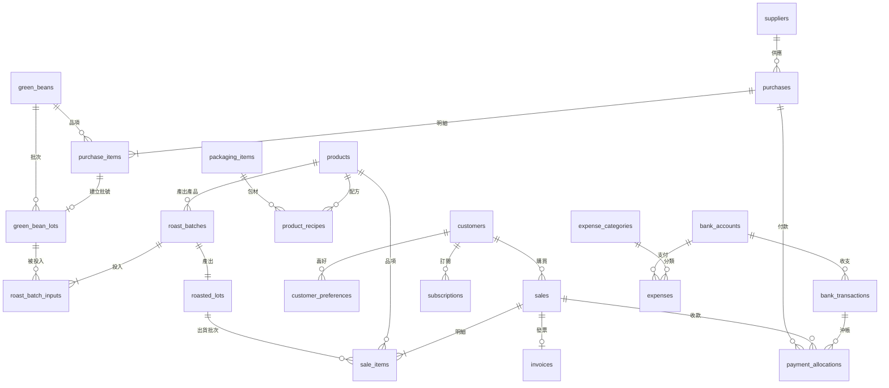

# 咖啡烘豆進銷存系統 — 系統架構與資料表設計

> 本文件為 [README.md](./README.md) 的詳細規格。
> 欄位標記：**PK** 主鍵、**FK** 外鍵、**IDX** 建議索引、`auto` 系統自動計算
>
> **實作狀態**：Phase 1 已完成（建表語法見 `db/schema.sql`）。Phase 1 的實作決議與對原規格的調整集中記錄在 [第 11 節](#11-phase-1-實作決議)，各表欄位也已同步更新。
> 技術選型：Cloudflare Pages（前端）＋ Pages Functions／Workers（API）＋ D1（SQLite）。

---

## 目錄

1. [模組總覽](#1-模組總覽)
2. [主檔](#2-主檔)
3. [交易](#3-交易)
4. [庫存與生產](#4-庫存與生產)
5. [財務](#5-財務)
6. [系統](#6-系統)
7. [資料表關聯（ER）](#7-資料表關聯er)
8. [業務規則](#8-業務規則)
9. [日期區間查詢與報表](#9-日期區間查詢與報表)
10. [原規劃檢查結果](#10-原規劃檢查結果)
11. [Phase 1 實作決議](#11-phase-1-實作決議)

---

## 1. 模組總覽

| 模組 | 資料表 | 狀態 |
|---|---|---|
| 主檔 | 供應商 suppliers | 原規劃 |
| | 客戶 customers | 原規劃 |
| | 客戶喜好 customer_preferences | 原規劃 |
| | 產品 products | 原規劃 |
| | 生豆品項 green_beans | **新增** |
| | 配方 product_recipes | **新增** |
| | 包材 packaging_items | **新增**（主檔與進貨已提前至 Phase 1） |
| | 銀行帳戶 bank_accounts | **新增** |
| 交易 | 進貨 purchases / purchase_items | 原規劃 |
| | 銷貨 sales / sale_items | 原規劃 |
| | 退貨／折讓 returns / return_items | **新增** |
| | 訂閱訂單 subscriptions | **新增** |
| | 發票 invoices | **新增** |
| 庫存與生產 | 生豆庫存 green_bean_lots | 原規劃（改為批號制） |
| | 烘焙批次 roast_batches / roast_batch_inputs | **新增** |
| | 熟豆庫存 roasted_lots | **新增** |
| | 庫存異動 inventory_movements | **新增** |
| | 盤點 stock_counts / stock_count_items | **新增** |
| | 單號流水號 doc_sequences | **新增**（Phase 1） |
| 財務 | 銀行收支 bank_transactions | 原規劃 |
| | 收付款沖帳 payment_allocations | **新增** |
| | 費用支出 expenses | **新增** |
| | 費用類別 expense_categories | **新增** |
| 系統 | 使用者 users | **新增** |
| | 操作日誌 audit_logs | **新增** |

---

## 2. 主檔

### 2.1 供應商 `suppliers`

| 欄位 | 型別 | 說明 |
|---|---|---|
| supplier_id | PK | 供應商編號 |
| name | text | 名稱 |
| tax_id | text | 統一編號 |
| contact_name | text | 聯絡人 |
| phone / email | text | 聯絡方式 |
| address | text | 地址 |
| country | text | 國家（國外生豆商） |
| payment_terms | text | 付款條件（現結／月結 30 天） |
| bank_info | text | 匯款資訊 |
| note | text | 備註 |
| is_active | bool | 是否啟用 |
| created_at / updated_at | datetime | |

### 2.2 客戶 `customers`

| 欄位 | 型別 | 說明 |
|---|---|---|
| customer_id | PK | 客戶編號 |
| name | text | 姓名／公司名 |
| customer_type | enum | 零售／批發／咖啡廳／電商 |
| price_level | enum | 價格等級（零售價／批發價／VIP） |
| tax_id | text | 統一編號（開三聯式發票用） |
| phone / email / line_id | text | 聯絡方式 |
| shipping_address | text | 收件地址 |
| payment_terms | text | 現結／月結 |
| credit_limit | decimal | 信用額度（批發客戶） |
| birthday | date | 生日（行銷用，選填） |
| source | text | 客戶來源 |
| note | text | 備註 |
| is_active | bool | |
| created_at / updated_at | datetime | |

### 2.3 客戶喜好 `customer_preferences`（客戶子表，一個客戶可有多筆；Phase 1 已實作）

| 欄位 | 型別 | 說明 |
|---|---|---|
| pref_id | PK | |
| customer_id | FK → customers | |
| roast_level | enum | 淺焙／中焙／中深焙／深焙 |
| flavor_notes | text | 偏好風味（花香、果酸、堅果、巧克力） |
| grind_size | enum | 原豆／手沖／義式／法壓／冷萃 |
| brew_method | text | 沖煮器具 |
| favorite_products | text | 常買品項 |
| dislikes | text | 不喜歡的風味 |
| note | text | |
| updated_at | datetime | |

### 2.4 生豆品項 `green_beans`

| 欄位 | 型別 | 說明 |
|---|---|---|
| bean_id | PK | 生豆品項編號 |
| name | text | 品名（例：衣索比亞 耶加雪菲 G1） |
| country | text | 國家 |
| region | text | 產區 |
| farm | text | 莊園／處理廠 |
| process | enum | 水洗／日曬／蜜處理／厭氧／其他 |
| variety | text | 品種 |
| altitude | text | 海拔 |
| crop_year | text | 產季 |
| cupping_score | decimal | 杯測分數 |
| default_supplier_id | FK → suppliers | 常用供應商 |
| safety_stock_kg | decimal | 安全庫存量 |
| note | text | |
| is_active | bool | |
| created_at / updated_at | datetime | |

### 2.5 產品 `products`

| 欄位 | 型別 | 說明 |
|---|---|---|
| product_id | PK | 產品編號 |
| sku | text | 料號／條碼（不可重複，可空白） |
| name | text | 產品名稱 |
| category | enum | 單品豆／綜合豆／濾掛／禮盒／器具／其他 |
| roast_level | enum | 烘焙度 |
| net_weight_g | int | 每包淨重（g） |
| retail_price | decimal | 零售價 |
| wholesale_price | decimal | 批發價 |
| shelf_life_days | int | 賞味期（天，從烘焙日起算） |
| note | text | 備註 |
| is_active | bool | |
| created_at / updated_at | datetime | |

### 2.6 配方 `product_recipes`（產品 BOM）

| 欄位 | 型別 | 說明 |
|---|---|---|
| recipe_id | PK | |
| product_id | FK → products | 產品 |
| component_type | enum | 熟豆／包材 |
| component_id | FK | 對應 green_beans 或 packaging_items |
| qty | decimal | 用量（熟豆 g、包材 個） |

> 例：「招牌綜合 250g」= 巴西 150g + 哥倫比亞 100g + 夾鏈袋 1 個 + 標籤 1 張

### 2.7 包材 `packaging_items`

| 欄位 | 型別 | 說明 |
|---|---|---|
| packaging_id | PK | |
| name | text | 名稱（250g 單向閥夾鏈袋、標籤、濾掛袋、禮盒） |
| unit | text | 單位 |
| unit_cost | decimal | 參考單價 |
| supplier_id | FK → suppliers | |
| safety_stock | int | 安全庫存 |
| note | text | 備註 |
| is_active | bool | 是否啟用 |
| created_at / updated_at | datetime | |

> 包材庫存同樣由 `inventory_movements`（item_type = 包材）加總，見 view `v_packaging_stock`。

### 2.8 銀行帳戶 `bank_accounts`

| 欄位 | 型別 | 說明 |
|---|---|---|
| account_id | PK | |
| account_name | text | 帳戶名稱（例：台銀公司戶） |
| account_type | enum | 銀行／現金／LINE Pay／信用卡收單／電商平台 |
| bank_name | text | 銀行名稱 |
| account_no_masked | text | 帳號末四碼（不存完整帳號） |
| opening_balance | decimal | 期初餘額 |
| opening_date | date | 期初日期 |
| is_active | bool | |

---

## 3. 交易

### 3.1 進貨 `purchases`（表頭）

| 欄位 | 型別 | 說明 |
|---|---|---|
| purchase_id | PK | 內部流水編號（整數） |
| purchase_no | text UNIQUE | 進貨單號。自動產生 `P{YYYYMMDD}-{NN}`（例：P20261114-01），存檔前可手動修改 |
| purchase_date | date **IDX** | 進貨日期 |
| supplier_id | FK → suppliers **IDX** | |
| items_amount | decimal `auto` | 明細小計合計 |
| shipping_fee | decimal | 運費／報關費（攤入生豆成本） |
| tax_amount | decimal | 稅額（攤入生豆成本） |
| total_amount | decimal `auto` | 合計 = 明細小計 + 運費 + 稅額 |
| invoice_no | text | 供應商發票號碼 |
| payment_status | enum `auto` | 未付／部分付款／已付清（Phase 1 一律「未付」，Phase 3 沖帳後自動更新） |
| due_date | date | 應付日期 |
| note | text | |
| created_by | text | 操作者 email（Cloudflare Access） |
| created_at / updated_at | datetime | |

> 金額一律新台幣；國外供應商請換算成台幣後輸入。

### 3.2 進貨明細 `purchase_items`

| 欄位 | 型別 | 說明 |
|---|---|---|
| item_id | PK | |
| purchase_id | FK → purchases | |
| line_no | int | 明細行號（同一張單內不重複） |
| item_type | enum | 生豆／包材（「其他」尚未開放） |
| bean_id / packaging_id | FK | 品項（依 item_type 二擇一） |
| qty | decimal | 數量（生豆 kg／包材依主檔單位） |
| unit_price | decimal | 單價 |
| amount | decimal `auto` | 小計 = 數量 × 單價 |
| alloc_amount | decimal `auto` | 攤入的運費＋稅額（只有生豆有，包材為 0） |
| landed_unit_cost | decimal `auto` | 入庫單位成本 =（小計 + 攤提）÷ 數量 |
| note | text | |

> 生豆批號 `lot_no` 不存在明細表，存檔時寫入 `green_bean_lots`（以 `purchase_item_id` 一對一對應）。

### 3.3 銷貨 `sales`（表頭）

| 欄位 | 型別 | 說明 |
|---|---|---|
| sale_id | PK | 銷貨單號 |
| sale_date | date **IDX** | 銷貨日期 |
| customer_id | FK → customers **IDX** | 散客可為空 |
| channel | enum | 門市／電話／LINE／官網／蝦皮／批發 |
| subtotal | decimal `auto` | |
| discount | decimal | 折扣 |
| shipping_fee | decimal | 運費 |
| total_amount | decimal `auto` | |
| payment_method | enum | 現金／轉帳／LINE Pay／刷卡／貨到付款 |
| payment_status | enum `auto` | 未收／部分收款／已收清 |
| due_date | date | 應收日期（月結） |
| invoice_id | FK → invoices | |
| subscription_id | FK → subscriptions | 訂閱產生的訂單 |
| note | text | |

### 3.4 銷貨明細 `sale_items`

| 欄位 | 型別 | 說明 |
|---|---|---|
| item_id | PK | |
| sale_id | FK → sales | |
| product_id | FK → products | |
| roasted_lot_id | FK → roasted_lots | 出貨熟豆批次（追溯用） |
| grind_size | enum | 研磨度 |
| qty | int | 數量 |
| unit_price | decimal | 單價 |
| unit_cost | decimal `auto` | 出貨當下成本（算毛利用） |
| amount | decimal `auto` | 小計 |

> **客戶購買紀錄** = `sales JOIN sale_items WHERE customer_id = ?`，不另建表。

### 3.5 退貨／折讓 `returns` / `return_items`

| 欄位 | 型別 | 說明 |
|---|---|---|
| return_id | PK | |
| return_date | date **IDX** | |
| return_type | enum | 銷貨退回／銷貨折讓／進貨退出 |
| ref_sale_id / ref_purchase_id | FK | 原單據 |
| reason | text | 原因 |
| restock | bool | 是否回補庫存 |
| total_amount | decimal | |

明細表 `return_items`：return_id、product_id／bean_id、qty、unit_price、amount。

### 3.6 訂閱訂單 `subscriptions`

| 欄位 | 型別 | 說明 |
|---|---|---|
| subscription_id | PK | |
| customer_id | FK → customers | |
| product_id | FK → products | 或「當月推薦」 |
| qty | int | 每期數量 |
| frequency | enum | 每週／雙週／每月 |
| next_ship_date | date | 下次出貨日 |
| price | decimal | 每期金額 |
| start_date / end_date | date | |
| status | enum | 進行中／暫停／取消 |

### 3.7 發票 `invoices`

| 欄位 | 型別 | 說明 |
|---|---|---|
| invoice_id | PK | |
| invoice_no | text | 發票號碼 |
| invoice_date | date **IDX** | |
| invoice_type | enum | 二聯／三聯／電子發票 |
| buyer_tax_id | text | 買方統編 |
| carrier | text | 載具 |
| amount / tax | decimal | |
| status | enum | 開立／作廢／折讓 |

---

## 4. 庫存與生產

### 4.1 生豆庫存（批號） `green_bean_lots`

| 欄位 | 型別 | 說明 |
|---|---|---|
| lot_id | PK | 內部流水編號（整數） |
| lot_no | text UNIQUE | 生豆批號。自動產生 `L{YYYYMMDD}-{NN}`（例：L20261114-01），存檔前可手動修改 |
| bean_id | FK → green_beans **IDX** | |
| purchase_item_id | FK → purchase_items（UNIQUE） | 來源進貨明細 |
| received_date | date **IDX** | 入庫日期（= 進貨日期） |
| initial_kg | decimal | 入庫重量 |
| unit_cost | decimal | 每 kg 成本（含攤提運費＋稅額） |
| storage_location | text | 存放位置 |
| note | text | |
| created_at | datetime | |

> `current_kg`（現有重量）與 `status`（使用中／已用完）**不存欄位**，由 view `v_green_bean_lot_stock` 依 `inventory_movements` 加總即時算出；view 另提供 `other_movement_count`（進貨入庫以外的異動筆數，> 0 代表批號已被使用）。

### 4.2 烘焙批次 `roast_batches`（簡化版）

| 欄位 | 型別 | 說明 |
|---|---|---|
| batch_id | PK | 批次編號（例：R20261114-01） |
| roast_date | date **IDX** | 烘焙日期（熟豆賞味期起算日） |
| product_id | FK → products | 產出產品 |
| input_total_kg | decimal `auto` | 投入總重（明細加總） |
| output_kg | decimal | **產出熟豆 kg（手動輸入）** |
| loss_rate | decimal `auto` | 失重率 =（投入 − 產出）÷ 投入 |
| input_total_cost | decimal `auto` | 投入生豆總成本 |
| unit_cost | decimal `auto` | 熟豆每 kg 成本 = 投入總成本 ÷ 產出 kg |

### 4.3 烘焙投入明細 `roast_batch_inputs`

| 欄位 | 型別 | 說明 |
|---|---|---|
| input_id | PK | |
| batch_id | FK → roast_batches | |
| lot_id | FK → green_bean_lots | **投入哪一批生豆** |
| input_kg | decimal | **投入公斤數** |
| unit_cost | decimal `auto` | 帶入該 Lot 成本 |

> 一個烘焙批次可投入多個生豆批號（綜合豆，或同一支豆子湊不同進貨批次）。

### 4.4 熟豆庫存 `roasted_lots`

| 欄位 | 型別 | 說明 |
|---|---|---|
| roasted_lot_id | PK | |
| batch_id | FK → roast_batches | 來源烘焙批次 |
| product_id | FK → products | |
| roast_date | date | 烘焙日 |
| best_before | date `auto` | 賞味期限 = 烘焙日 + 產品賞味天數 |
| initial_kg | decimal | 產出重量 |
| current_kg | decimal `auto` | 現有重量 |
| unit_cost | decimal | 每 kg 成本 |

### 4.5 庫存異動 `inventory_movements`（核心表）

| 欄位 | 型別 | 說明 |
|---|---|---|
| movement_id | PK | |
| movement_date | datetime **IDX** | |
| item_type | enum | 生豆／熟豆／包材／成品 |
| item_ref_id | FK | lot_id／roasted_lot_id／packaging_id／product_id |
| movement_type | enum | 進貨入庫／烘焙投入／烘焙產出／包裝耗用／銷貨出庫／退貨／盤盈／盤虧／試喝／樣品／報廢 |
| qty | decimal | 正數 = 入庫、負數 = 出庫 |
| unit_cost | decimal | |
| amount | decimal `auto` | qty × unit_cost（帶正負號，加總即為庫存金額） |
| ref_doc_type / ref_doc_id | text / int | 來源單據（例：purchases / purchase_id） |
| ref_item_id | int | 來源單據明細（例：purchase_items.item_id） |
| note | text | |
| created_by | text | 操作者 email（Cloudflare Access；Phase 5 建立 users 表後再關聯） |
| created_at | datetime | |

> 所有庫存數量皆由此表加總計算，**不直接修改庫存數字**。

> 進貨入庫的 `movement_date` = 進貨日期 00:00:00。索引：`movement_date`、`(item_type, item_ref_id, movement_date)`、`(ref_doc_type, ref_doc_id)`。

### 4.5.1 單號流水號 `doc_sequences`

| 欄位 | 說明 |
|---|---|
| prefix + ymd | PK。prefix：`P` 進貨單、`L` 生豆批號；ymd：`YYYYMMDD` |
| last_no | 當日已用到的最大流水號（只增不減，刪單後號碼不重複使用） |

### 4.6 盤點 `stock_counts` / `stock_count_items`

| 欄位 | 說明 |
|---|---|
| count_id、count_date、note | 盤點單表頭 |
| item_type、item_ref_id、system_qty、actual_qty、diff_qty `auto` | 明細：差異自動產生盤盈／盤虧異動 |

---

## 5. 財務

### 5.1 銀行收支 `bank_transactions`

| 欄位 | 型別 | 說明 |
|---|---|---|
| txn_id | PK | |
| account_id | FK → bank_accounts **IDX** | |
| txn_date | date **IDX** | 交易日期 |
| direction | enum | 入帳／出帳 |
| amount | decimal | 金額（正數） |
| category | enum | 銷貨收款／進貨付款／費用／轉帳／手續費／利息／其他 |
| counterparty | text | 交易對象 |
| description | text | 摘要 |
| ref_doc_type / ref_doc_id | text | 對應單據（sales／purchases／expenses） |
| reconciled | bool | 是否已對帳 |
| bank_ref_no | text | 銀行交易序號（匯入 CSV 時比對用） |

> 帳戶餘額 = 期初餘額 + Σ入帳 − Σ出帳（依日期即可算出任一天餘額）

### 5.2 收付款沖帳 `payment_allocations`

| 欄位 | 說明 |
|---|---|
| allocation_id | PK |
| txn_id | FK → bank_transactions |
| doc_type / doc_id | 沖銷的銷貨單或進貨單 |
| amount | 沖銷金額 |

> 一筆匯款可沖多張單（批發客戶月結），一張單也可分多次收款。

### 5.3 費用支出 `expenses` / 費用類別 `expense_categories`

| 欄位 | 說明 |
|---|---|
| expense_id | PK |
| expense_date | date **IDX** |
| category_id | FK → expense_categories（房租／瓦斯／電費／水費／運費／平台手續費／行銷／設備維修／薪資／雜支） |
| amount | 金額 |
| vendor | 廠商 |
| invoice_no | 發票號碼 |
| account_id | FK → bank_accounts（從哪個帳戶付） |
| allocate_to_roast | bool：是否攤入烘焙成本（瓦斯、電費） |
| note | 備註 |

---

## 6. 系統

### 6.1 使用者 `users`

| 欄位 | 說明 |
|---|---|
| user_id、name、email、role（管理者／烘豆師／門市／會計）、is_active |

### 6.2 操作日誌 `audit_logs`

| 欄位 | 說明 |
|---|---|
| log_id、user_id、action（新增／修改／刪除）、table_name、record_id、before_json、after_json、created_at |

---

## 7. 資料表關聯（ER）



---

## 8. 業務規則

### 8.1 進貨存檔（Phase 1 已實作）
1. 生豆明細 → 建立 `green_bean_lots`（批號）；包材明細不建批號
2. 生豆、包材明細皆寫入 `inventory_movements`（進貨入庫，+數量）
3. **成本攤提**：運費／報關費＋稅額**只攤給生豆**，依 kg 比例攤入每 kg 成本（尾差歸最後一筆生豆）；包材維持原單價。整張單沒有生豆時不攤提，運費與稅額只計入合計
   ```
   攤提金額(每筆生豆) = (運費 + 稅額) × 該筆 kg ÷ 本單生豆總 kg
   生豆每 kg 成本     = (小計 + 攤提金額) ÷ kg
   合計               = 明細小計 + 運費 + 稅額
   ```
4. 付款狀態預設「未付」，產生應付帳款
5. **單號／批號**：進貨單號 `P{YYYYMMDD}-{NN}`、批號 `L{YYYYMMDD}-{NN}`（日期為進貨日期、當日流水號），留空自動產生，也可手動輸入，不可重複
6. **修改／刪除**：進貨單內的生豆批號都還沒有其他異動（烘焙投入、樣品、盤點…）時可修改或刪除，修改時整張重寫明細、批號與異動；任一批號已被使用，或已有付款紀錄 → 整張單鎖定，只能檢視
7. 表頭、明細、批號、異動在同一個 D1 batch（單一交易）內完成

### 8.2 烘焙批次存檔
1. 每筆投入明細 → `inventory_movements`（烘焙投入，−kg）扣生豆庫存
2. 建立 `roasted_lots` → `inventory_movements`（烘焙產出，+kg）
3. 自動計算：
   ```
   投入總重     = Σ roast_batch_inputs.input_kg
   失重率       = (投入總重 − 產出熟豆 kg) ÷ 投入總重
   投入總成本   = Σ (input_kg × lot.unit_cost)
   熟豆每kg成本 = 投入總成本 ÷ 產出熟豆 kg
   ```
4. 檢核：生豆 Lot 庫存不足時禁止存檔；失重率 < 10% 或 > 25% 時提醒確認

### 8.3 銷貨存檔
1. 依產品配方扣熟豆與包材（`inventory_movements` 銷貨出庫／包裝耗用）
2. 熟豆以**先進先出（FIFO）**挑選最早烘焙的 `roasted_lots`
3. 記錄 `unit_cost` 供毛利計算
4. 現結 → 同時建立 `bank_transactions` 入帳；月結 → 產生應收帳款

### 8.4 收付款
- 銀行入帳／出帳透過 `payment_allocations` 沖銷單據
- 單據 `payment_status` 依已沖銷金額自動更新

### 8.5 庫存預警
- 生豆現有量 < `safety_stock_kg` → 補貨提醒
- 包材現有量 < `safety_stock` → 補貨提醒
- 熟豆距賞味期限 ≤ 7 天 → 出清提醒

### 8.6 訂閱
- 每日檢查 `next_ship_date`，自動產生銷貨單草稿，出貨後推算下次日期

---

## 9. 日期區間查詢與報表

所有查詢皆支援 **起日～迄日** 篩選，並可匯出 Excel。

| 報表 | 篩選條件 | 內容 |
|---|---|---|
| 進貨查詢 | 日期、供應商、生豆品項 | 進貨明細、金額合計、未付款 |
| 銷貨查詢 | 日期、客戶、產品、通路 | 銷貨明細、營業額、未收款 |
| 客戶購買紀錄 | 日期、客戶 | 歷次購買、累計金額、最近購買日、常買品項 |
| 烘焙紀錄 | 日期、產品、生豆批號 | 批次、投入／產出、失重率、成本 |
| 失重率分析 | 日期、生豆品項 | 各品項平均失重率趨勢 |
| 庫存異動 | 日期、品項、異動類型 | 任一品項的進出明細 |
| 庫存現況 | 截止日期 | 生豆／熟豆／包材數量與金額 |
| 批號追溯 | 熟豆批次或生豆批號 | 生豆 → 烘焙 → 出貨給哪些客戶 |
| 銀行收支 | 日期、帳戶、類別 | 入帳／出帳明細、期初期末餘額 |
| 應收帳款 | 截止日期、客戶 | 帳齡分析（30／60／90 天） |
| 應付帳款 | 截止日期、供應商 | 待付款清單 |
| 費用分析 | 日期、類別 | 各類費用合計 |
| 毛利分析 | 日期、產品、客戶 | 營收 − 成本 = 毛利、毛利率 |
| 損益概要 | 月／季／年 | 營收 − 銷貨成本 − 費用 = 淨利 |

---

## 10. 原規劃檢查結果

| 原規劃 | 檢查結果 | 調整 |
|---|---|---|
| 供應商資料檔 | ✅ 保留 | 加付款條件、匯款資訊 |
| 客戶資料檔 | ✅ 保留 | 加客戶類型、價格等級、月結條件 |
| 購買紀錄 | ⚠️ 與銷貨重複 | 改為銷貨的查詢視圖，不另建表 |
| 喜好 | ✅ 保留 | 改為客戶子表，欄位結構化 |
| 進貨資料檔 | ✅ 保留 | 拆表頭／明細，明細建立生豆批號 |
| 銷貨資料檔 | ✅ 保留 | 拆表頭／明細，記錄出貨熟豆批次與成本 |
| 生豆庫存資料檔 | ⚠️ 需調整 | 拆成「生豆品項主檔」＋「生豆批號庫存」 |
| 產品資料檔 | ✅ 保留 | 加配方 BOM、賞味天數、多價格 |
| 日期區間查詢 | ✅ 保留 | 所有單據日期欄位建索引 |
| 銀行入帳出帳 | ⚠️ 需補強 | 加帳戶主檔、沖帳表、對帳狀態 |
| — | ❌ 缺少 | **烘焙批次**（生豆 → 熟豆轉換） |
| — | ❌ 缺少 | 熟豆庫存、包材庫存、庫存異動表 |
| — | ❌ 缺少 | 應收／應付、費用支出 |
| — | ❌ 缺少 | 退貨折讓、盤點、訂閱、發票、權限日誌 |

---

## 11. Phase 1 實作決議

開發 Phase 1 時與使用者確認的決議，以及因此對原規格的調整。

| # | 項目 | 決議 |
|---|---|---|
| 1 | 進貨品項 | 生豆＋包材。包材主檔 `packaging_items` 與包材庫存由 Phase 4 提前到 Phase 1；item_type「其他」暫不開放 |
| 2 | 稅額 | 稅額與運費一樣攤入成本（不視為可扣抵進項稅） |
| 3 | 混合進貨攤提 | 運費＋稅額只攤給生豆、依 kg 比例；包材不攤 |
| 4 | 編號 | 進貨單號、生豆批號自動產生且可修改。主鍵改用整數流水號，另設 `purchase_no`、`lot_no`（UNIQUE） |
| 5 | 進貨單修改 | 批號未被使用前可修改／刪除，使用後鎖定 |
| 6 | 介面 | API ＋ 後台管理頁（`web/admin`，繁體中文，紅 = 增加／入庫、綠 = 減少／出庫） |
| 7 | 登入驗證 | Cloudflare Access。API 驗證 `Cf-Access-Jwt-Assertion`，以 email 寫入 `created_by`；`users` 表仍在 Phase 5 |
| 8 | 庫存查詢 | 生豆品項彙總（期初／入庫／出庫／期末 kg 與金額），可展開批號，再點入異動明細 |
| 9 | 客戶喜好 | `customer_preferences` 與客戶主檔一起在 Phase 1 完成 |
| 10 | 幣別 | 一律新台幣，不記外幣與匯率 |

其他實作細節：

- **現有庫存不存欄位**：`green_bean_lots.current_kg`／`status` 改由 view 計算，避免與異動表不一致。
- **日期區間庫存**：期初 = 起日之前的異動加總；期末 = 迄日當天結束的庫存；未給起日則期初為 0。
- **主檔刪除**：已被單據或庫存異動引用的主檔不可刪除，改用 `is_active` 停用。
- **enum 欄位**直接存中文值，以 CHECK 限制；日期存 `YYYY-MM-DD` 文字，時間為台灣時間（UTC+8）。
- **D1 沒有互動式交易**，以 `db.batch()` 達成「單據與庫存在同一交易內完成」。

### API 一覽（Phase 1）

| 路徑 | 方法 | 說明 |
|---|---|---|
| `/api/suppliers`、`/api/customers`、`/api/green-beans`、`/api/packaging-items`、`/api/products` | GET（`?q=&active=`）／POST | 列表、新增 |
| 同上 `/{id}` | GET／PUT／PATCH／DELETE | 讀取、修改、刪除。客戶的 `preferences` 陣列隨客戶一起讀寫 |
| `/api/purchases` | GET（`?from=&to=&supplier_id=&bean_id=`）／POST | 進貨查詢（含合計、未付款）、新增 |
| `/api/purchases/{id}` | GET／PUT／DELETE | 讀取（含 `locked`）、修改、刪除 |
| `/api/purchases/next-no?date=` | GET | 預覽下一個進貨單號與批號流水號 |
| `/api/inventory/green-beans` | GET（`?from=&to=&bean_id=&show_empty=1`） | 生豆庫存：品項彙總＋批號 |
| `/api/inventory/packaging` | GET（`?from=&to=`） | 包材庫存 |
| `/api/inventory/movements` | GET（`?item_type=&from=&to=&bean_id=&lot_id=&packaging_id=&movement_type=`） | 庫存異動明細 |
| `/api/me` | GET | 目前登入者 |
